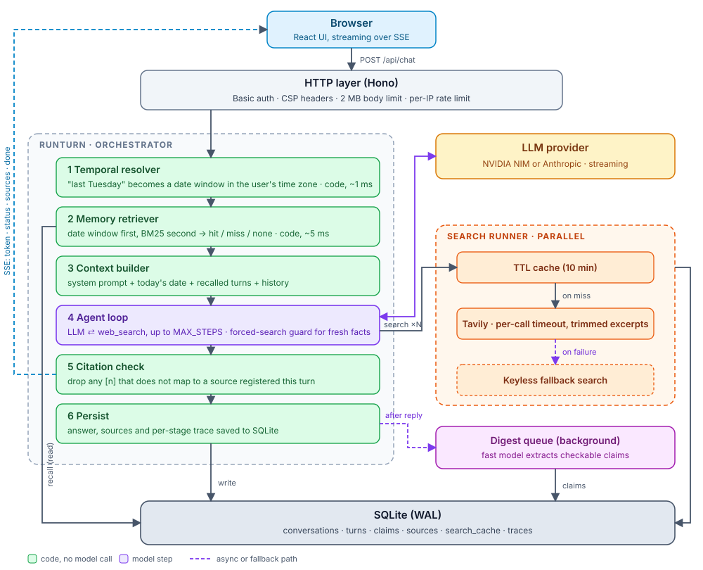

# DESIGN

## What it is

A chat agent with one tool, web search, plus a time-indexed memory of its own past conversations. It answers "Last Tuesday I asked about Postgres hosting — has pricing changed?" by finding what it said that day, re-checking those specific claims on the live web, and reporting what changed.

## How I read the problem

Every sample query has the same shape: a date reference, a past exchange, and "compare then with now". The hard parts are not "call a search API":

1. Map "Monday", "3 November", "last Tuesday" to the right stored exchange.
2. Know exactly what was claimed then, so it can be checked.
3. Be honest when there is no record, or the web doesn't confirm.

## How it works

Code resolves date expressions into windows in the user's time zone, then retrieves matching past turns from SQLite (date window first, BM25 on topic second) or produces an explicit "no record" result. That goes in the prompt. One model loop runs with the single tool `web_search`, issuing independent searches in parallel and writing a cited answer. After the answer streams, a fast model extracts checkable claims (`subject, attribute, value, source, volatility`) and stores them, so a later "is that still true?" has exact targets.

## Decisions and why

- **Memory is not a tool.** The brief gives one tool. Recall runs in code before the model: no extra round-trip, and weekday arithmetic is always right.
- **Explicit miss.** If nothing is stored for the resolved date, the model is told so and must not treat the user's description as the record. This is what stops "the five tools we shortlisted" being invented.
- **Claims extracted at write time**, off the hot path, so verification starts from structured rows rather than re-reading old prose.
- **One loop, parallel calls, no router or planner.** Each extra model stage costs about a second and adds a place to be wrong.
- **Freshness is guaranteed in code.** Small models answer from stale training data, so a fresh-data question that gets no tool call is searched for by the agent (follow-ups rewritten into standalone queries). The final step withholds the tool so the loop always ends.
- **Citations are validated.** Any `[n]` that doesn't map to a source registered this turn is stripped.
- **Ambiguous dates produce candidates, not guesses**, and the answer states the date it used.
- **Three verdicts:** Changed, Unchanged, Could not verify. "Unchanged" requires a current source confirming the old value.
- **Time is injected** through one `Clock`, so dated queries are testable on a fresh install.
- **No framework, no vector DB.** One person's history is thousands of rows, queried by date; a date index plus in-memory BM25 is enough and adds no key or latency. `node:sqlite` avoids native compilation (Node ≥ 22.13).

**Rejected:** memory as a model tool (slower, less reliable); a planner/router stage (latency); embeddings + vector DB (overkill for date-anchored recall); LangChain-style frameworks (hides the loop I need to explain).

## Measured

Latency, real pipeline against the live LLM and live web search, cold search cache, median of 3 runs (`npm run eval:latency`; default free-tier NVIDIA NIM models, so a faster model will be faster):

| Query class | Model calls | First token p50 | Total p50 | Searches |
|---|---|---|---|---|
| No search | 1 | 1.0 s | 1.0 s | 0 |
| Recall only | 1 | 1.0 s | 1.0 s | 0 |
| One search round | 2 | 1.3 s | 1.7 s | 1 |
| Recall + verify (CRM example) | 4 | 8.9 s | 9.2 s | 3 |

The verify case is slow because it takes several model steps before the answer starts; first token ≈ total means the answer arrives in one burst after the last search step.

Correctness (`npm run eval`, scripted LLM and mock search, frozen clock, so this tests the pipeline's logic rather than model quality): **20/20** cases pass (recall, parallel searches, citations, no fabrication on both miss cases E7/E8, prompt-injection in results ignored); `npm test`: 54 tests, 31 of them date-resolution cases.

## Limits

- One shared password at most (optional HTTP Basic); no per-user accounts. One process, one SQLite file.
- Retrieval is lexical: a recall with no date and no shared words ("that database thing") can miss.
- Claims are model-extracted and can miss or mis-scope one; the raw answer is always passed alongside as the fallback.
- Pages that render prices only via JavaScript may come back without the number; the agent then says "could not verify".
- In the live CRM run the model chose 3 searches for 5 tools; the cap allows more, but nothing forces one search per tool.
- Search is Tavily with a best-effort keyless fallback.

## With another week

Embedding fallback for undated fuzzy recall; a deterministic one-search-per-entity fan-out for "check each of these"; stream a status line earlier in multi-step turns; scheduled re-checks of high-volatility claims; editable, user-visible memory; Postgres and real per-user auth.
