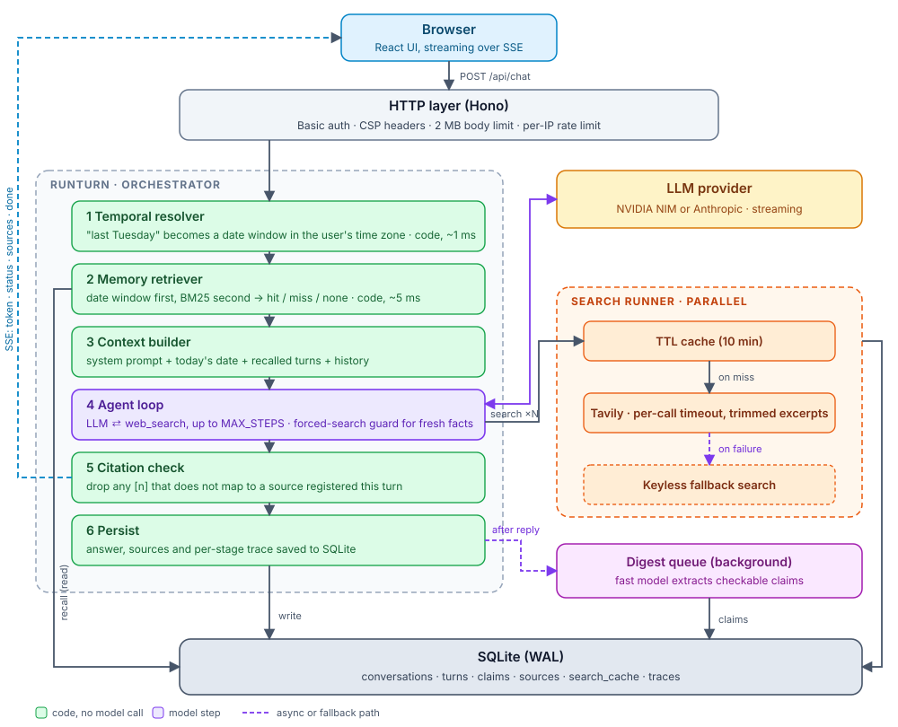

# Minimi — time-aware web search chat agent

A chat assistant with **one tool (`web_search`)** and a **time-indexed memory of its own past conversations**.
Ask it *"Last Tuesday I asked about Postgres hosting — has any pricing changed?"* and it finds what it said that
day, re-checks those exact claims on the live web, and reports what changed — with citations.

- **Live web answers with citations** — time-sensitive and factual questions always trigger a search; stable
  questions ("explain recursion") are answered instantly without one.
- **Temporal memory** — dates like "Monday", "3 November", "last Tuesday" are resolved in your time zone and matched
  against stored conversations (SQLite + BM25); if nothing was saved, it says so instead of guessing.
- **A complete chat UI** — streaming answers, live tool-call cards, regenerate with version history, thumbs
  up/down feedback, read-aloud, voice dictation, file attachments, search-approval mode, projects, pinned chats,
  ⌘K / Ctrl+K command palette, Runs (per-question execution traces), Files, Analytics, dark/light themes.
- **Provider-agnostic LLM** — works with **NVIDIA NIM** (free tier, OpenAI-compatible) or **Anthropic**.
- **Production-ready server** — security headers/CSP, optional password protection, rate limiting,
  health checks, graceful shutdown.

> **Reviewer in a hurry?** → jump to [Quick start](#quick-start-5-minutes) and then [What to try](#what-to-try-a-2-minute-tour).

---

## Contents

1. [Quick start (5 minutes)](#quick-start-5-minutes)
2. [API keys you need](#api-keys-you-need)
3. [What to try (a 2-minute tour)](#what-to-try-a-2-minute-tour)
4. [Testing & evaluation](#testing--evaluation)
5. [Configuration reference](#configuration-reference)
6. [Architecture](#architecture)
7. [Project structure](#project-structure)
8. [HTTP API](#http-api)
9. [Troubleshooting](#troubleshooting)
10. [Known limitations](#known-limitations)

---

## Quick start (5 minutes)

**Prerequisites:** [Node.js](https://nodejs.org) **≥ 22.13** (uses the built-in `node:sqlite`; verify with `node -v`)
and npm. No database server, no build tools — SQLite is a single local file.

```bash
# 1. Install
npm install

# 2. Configure — copy the template and paste your keys (see "API keys you need")
cp .env.example .env          # Windows PowerShell:  Copy-Item .env.example .env

# 3. Run
npm start                     # → http://localhost:3000
```

Open **http://localhost:3000**. The web bundle is built automatically on every start; the database
(`data/agent.db`) is created on first run. Use `npm run dev` for auto-restart on server changes.

**Minimum config:** one LLM key. Web search works without a key (keyless fallback), but a free Tavily key gives
noticeably better results.

---

## API keys you need

Put these in `.env` (a template with placeholders is in [`.env.example`](.env.example)). `.env` is git-ignored.

| Variable | Required? | Where to get it | Notes |
|---|---|---|---|
| `NVIDIA_API_KEY` | **Yes — this *or* Anthropic** | <https://build.nvidia.com> → sign in → any model → **Get API Key** | Free tier. Starts with `nvapi-`. Uses the OpenAI-compatible endpoint `https://integrate.api.nvidia.com/v1`. |
| `ANTHROPIC_API_KEY` | Alternative to NVIDIA | <https://console.anthropic.com/settings/keys> | Starts with `sk-ant-`. If set, it takes precedence over NVIDIA. |
| `TAVILY_API_KEY` | Optional (recommended) | <https://app.tavily.com> | Free tier. Starts with `tvly-`. Without it the app uses keyless web search (works, lower quality). You can also add it later in the UI under **Integrations → Web search**. |
| `ACCESS_TOKEN` | Only for public deployments | `openssl rand -base64 24` | Password for HTTP Basic auth in front of the whole app. |

Placeholder values (`…REPLACE_ME`) and empty values are treated as "not set", so a freshly copied
`.env.example` starts cleanly and tells you exactly what is missing instead of failing with a confusing 401.

**Choosing models.** Leave `MODEL_MAIN` / `MODEL_FAST` blank to use the recommended defaults for your provider
(NVIDIA: `poolside/laguna-xs-2.1` + `nvidia/nemotron-3.5-bolt-e4b`; Anthropic: `claude-sonnet-5-5` +
`claude-haiku-5-5`). NVIDIA model availability varies per account — list yours with:

```bash
curl -s https://integrate.api.nvidia.com/v1/models -H "Authorization: Bearer $NVIDIA_API_KEY"
```

You can verify both connections without chatting: open **Integrations** in the sidebar and press **Test connection**.

---

## What to try (a 2-minute tour)

1. **Live search with citations** — ask *"Who is the CEO of Microsoft?"*. You'll see a `web_search` card appear with
   timing, an answer with `[1]` citations, and a source chip.
2. **Follow-ups keep context** — then ask *"and when was it founded?"*. It stays in the same chat and searches for
   the right thing (the question is rewritten into a standalone query).
3. **No search when it isn't needed** — *"Explain connection pooling in two sentences."* answers instantly.
4. **Temporal memory** — load demo history, then ask about it:
   ```bash
   npm run seed        # adds "last Monday: CRM tools" and "last Tuesday: Postgres hosting" demo chats
   ```
   Ask: *"Last Tuesday I asked about Postgres hosting. Has any pricing changed?"* — it recalls that conversation,
   re-checks the claims on the web, and reports differences. Ask about a day with no history and it says it has no record.
5. **Message actions** — hover an answer: copy, **regenerate** (old answers become versions you can flip through),
   thumbs up/down (with a reason), **read aloud**.
6. **Attach a file** — **＋ → Attach text file** (`.txt .md .csv .json`, code), then ask about it.
7. **Request approval** — toggle it in the composer; the agent now asks before every web search (Approve / Decline).
8. **Behind the scenes** — **Runs** shows every question's pipeline (time resolution → memory → search → citations)
   with timings; **Analytics** shows real usage; **Folders** shows attached files and projects.

---

## Testing & evaluation

```bash
npm test             # 54 unit tests (temporal resolver, retrieval, BM25, citations, trimming, …)
npm run typecheck    # TypeScript for server and web client
npm run eval         # E1–E20 behavioural evals with a mock LLM + mock search — needs NO API keys (expect 20/20)
npm run eval:latency  # real latency: live LLM + live search, p50 per query class
npm run seed:fixtures  # load the F1–F8 eval fixture history into the DB
```

> The mock eval is run with the default agent limits from `.env.example`
> (`MAX_STEPS=4`, `MAX_SEARCHES_PER_STEP=12`). If you lowered them for speed, a few cases that require many
> parallel searches will (correctly) not reach their expected search counts.

---

## Configuration reference

All configuration is via environment variables (loaded from `.env`). Defaults shown.

| Variable | Default | Purpose |
|---|---|---|
| `NVIDIA_API_KEY` / `ANTHROPIC_API_KEY` | — | LLM provider (set one) |
| `LLM_BASE_URL` | `https://integrate.api.nvidia.com/v1` | OpenAI-compatible endpoint (NVIDIA mode) |
| `MODEL_MAIN` / `MODEL_FAST` | provider defaults | Answering model / background claim-extraction model |
| `TAVILY_API_KEY` | — | Web search; falls back to keyless search when empty or failing |
| `PORT` | `3000` | HTTP port |
| `HOST` | `127.0.0.1` | Bind address (`0.0.0.0` in containers/servers) |
| `NODE_ENV` | `development` | `production` hides dev endpoints and enables request logs |
| `DB_PATH` | `./data/agent.db` | SQLite file (use a persistent volume in production) |
| `DEFAULT_TZ` | `Asia/Kolkata` | Fallback IANA time zone when the browser doesn't send one |
| `ACCESS_TOKEN` / `ACCESS_USER` | — / `minimi` | HTTP Basic auth for the whole app (except `/health`) |
| `RATE_LIMIT_PER_MIN` | `30` | Chat requests per client IP per minute (`0` = off) |
| `TRUST_PROXY` | `0` | `1` = read client IP from `X-Forwarded-For` (only behind your own proxy) |
| `FORCE_SEARCH` | `1` | Search by default on factual/time-sensitive questions; `0` = model decides |
| `MAX_STEPS` | `4` | Max model↔tool rounds per question |
| `MAX_SEARCHES_PER_STEP` / `MAX_SEARCHES_PER_TURN` | `12` / `16` | Search fan-out limits |
| `SEARCH_TIMEOUT_MS` / `SEARCH_CACHE_TTL_SEC` | `6000` / `600` | Per-search timeout; result cache TTL |
| `CLOCK_OVERRIDE` | — | Dev only: pretend "now" is this ISO-8601 instant |

**Speed vs. coverage:** lowering `MAX_SEARCHES_PER_STEP` / `MAX_SEARCHES_PER_TURN` cuts latency on multi-topic
questions, but keep the per-step cap at 5 or more or a "check these 5 tools" question can't search them all.

---

## Architecture

One server process, one agent, one tool. Everything that can be decided in code is decided in code; the model is
only used for what needs language: choosing searches and writing the answer.



### Request lifecycle

1. **Resolve time in code.** `chrono-node` + Luxon turn "Monday", "3 Nov", "since last week" into concrete dates
   in the browser's time zone. The model never does date arithmetic.
2. **Recall in code, not as a tool.** Memory lookup is date window first, BM25 on topic second. It returns an
   explicit *hit*, *miss* ("no saved conversation for 3 Nov") or *none*. A miss is passed to the model as a fact,
   so it says "I have no record" instead of inventing one. No model round-trip is spent on memory.
3. **Search in parallel.** The model can emit several independent `web_search` calls in one step; they run
   concurrently, each with its own timeout, and results are trimmed to the relevant excerpts and numbered.
4. **Guarantee freshness.** Greetings, pure writing/coding tasks and memory questions skip search; everything else
   must search. If the model answers a fresh-data question without searching, the loop searches for it (follow-ups
   are rewritten into standalone queries) and re-asks. The last step withholds the tool so the loop always ends.
5. **Stream, then verify.** Tokens stream as they are produced. Afterwards every `[n]` citation is checked against
   the sources registered this turn; invalid ones are stripped, so a cited URL always exists.
6. **Learn after replying.** The digest queue extracts claims (subject, attribute, value, source, volatility)
   off the request path. "Is your answer still correct?" re-checks those claims against today's web.

### Production properties

| Concern | How it's handled |
|---|---|
| **Latency** | Time-to-first-status is sub-second (steps 1–3 are code). Searches fan out in parallel; a TTL cache (`SEARCH_CACHE_TTL_SEC`) absorbs repeats; the answer streams; digestion is off the critical path. |
| **Correctness** | Forced search for fresh facts, citation validation, explicit memory misses, dates resolved deterministically. |
| **Failure isolation** | Each search has a timeout and failure is reported to the model as a result, not an exception. Search falls back Tavily → keyless. The LLM adapter retries `429`/`5xx`. A failed digest never affects the answer. Client disconnect aborts the in-flight LLM and search calls (`AbortSignal`). |
| **Cost control** | Hard caps per turn (`MAX_STEPS`, `MAX_SEARCHES_PER_STEP`, `MAX_SEARCHES_PER_TURN`); a small fast model for digestion; prompt-cacheable system block. |
| **Security** | Optional Basic auth (`ACCESS_TOKEN`), strict CSP, request size limit, per-IP rate limit, API keys never sent to the browser, no stack traces in errors, dev endpoints off in production. |
| **Observability** | Every turn writes a trace (stage → duration → detail) to `traces`; the **Runs** view and `GET /api/trace/:turnId` show where time went. `GET /health` checks the DB. |
| **Testability** | The LLM, search provider, clock and DB are injected into `runTurn`, so the eval harness runs the real pipeline against a mock LLM/search and a controllable clock (`npm test`, `npm run eval`). |
| **Provider-agnostic** | `LLM` is a small interface with Anthropic and OpenAI-compatible (NVIDIA NIM) adapters; `SearchProvider` likewise. Swapping either is one file. |

Full rationale, rejected alternatives and measured latencies: [`DESIGN.md`](DESIGN.md).

---

## Project structure

```
src/
  server.ts          HTTP server, security middleware, chat SSE endpoint
  routes.ts          REST routes (conversations, projects, files, runs, stats, integrations, …)
  config.ts          Typed env config (+ provider-aware defaults)
  agent/             Agent loop, prompts, context building, citation handling, run-turn orchestration
  llm/               Provider adapters (Anthropic, OpenAI-compatible/NVIDIA)
  search/            Search providers (Tavily, keyless fallback), BM25 trimming, cache
  memory/            Temporal resolution, retrieval, BM25, digest queue, SQLite store
web/                 React client (esbuild-bundled at startup): chat, sidebar, Runs, Files, Analytics
scripts/             seed, eval harness, mock LLM/search, web build
test/                Vitest unit tests
schema.sql           SQLite schema (applied automatically at startup)
.env.example
```

---

## HTTP API

The UI uses these; they're handy for scripting too (add `-u minimi:$ACCESS_TOKEN` if auth is enabled).

| Method & path | Purpose |
|---|---|
| `GET /health` | Liveness/readiness (public, even with auth on) |
| `POST /api/chat` | Stream an answer (SSE). Body: `{ message, conversationId?, tz?, model?, approval?, attachmentIds?, regenerateTurnId? }`. Events: `conversation`, `memory`, `status`, `search_start`, `search_done`, `approval_request`, `token`, `sources`, `done`, `error` |
| `GET /api/conversations` · `GET/PATCH/DELETE /api/conversations/:id` | List, read, rename/pin/move, delete chats |
| `POST /api/projects` · `PATCH/DELETE /api/projects/:id` | Manage projects (folders) |
| `GET /api/search?q=` | Search across chats |
| `POST /api/attachments` · `GET /api/attachments[/:id]` · `DELETE /api/attachments/:id` | Text-file attachments |
| `POST /api/approve` · `POST /api/feedback` | Resolve a search approval · save thumbs up/down |
| `GET /api/runs` · `GET /api/runs/:id` · `GET /api/trace/:turnId` | Execution traces per question |
| `GET /api/stats` | Usage analytics |
| `GET /api/integrations` · `PUT /api/integrations/tavily` · `POST /api/integrations/test` | Connector status, set search key, connectivity test |
| `GET/POST /api/dev/clock` · `POST /api/import` | **Dev only** (disabled in production) |

Quick check from a terminal:

```bash
curl -N -X POST http://localhost:3000/api/chat -H 'Content-Type: application/json' \
  -d '{"message":"Who is the CEO of Microsoft?"}'
```

---

## Troubleshooting

| Symptom | Fix |
|---|---|
| `No LLM API key configured` | `.env` doesn't exist or still has the placeholder — copy `.env.example` → `.env` and paste a real key, then restart. |
| `LLM request failed (401/403)` | Key is wrong or expired. Test it in **Integrations → Test connection**. |
| `LLM request failed (404)` / "Function … not found" | That model isn't available to your account — pick another from `/v1/models` and set `MODEL_MAIN`. |
| `429` / slow answers on the free NVIDIA tier | The app retries automatically; try the lighter `MODEL_FAST` as `MODEL_MAIN`, or lower the search limits (see *Speed tip*). |
| Search results are weak or generic | Add a `TAVILY_API_KEY` (the keyless fallback is best-effort). |
| `node:sqlite` not found / `ERR_UNKNOWN_BUILTIN_MODULE` | Node is too old — install **Node ≥ 22.13**. |
| Port already in use | Set `PORT=3001` in `.env`. |
| Answers stop mid-stream behind a proxy | Turn off response buffering in your proxy (Server-Sent Events). |
| Fonts look different offline | The UI loads **Geist** from Google Fonts; offline it falls back to system fonts. |

---

